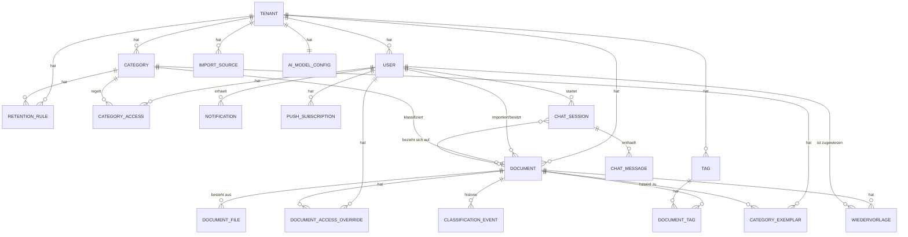

# Datenmodell: Famulus DMS

Stand: 09.09.2026 · Version 0.1 · Basis: Anforderungsdokument v0.1 (siehe `Anforderungsdokument.md`)

Dieses Dokument beschreibt das relationale Datenmodell für PostgreSQL (inkl. `pgvector`- und `pg_trgm`-Erweiterung). Es setzt die im Anforderungsdokument getroffenen Entscheidungen um: Multi-Tenant-Modell (Abschnitt 3), zweistufige Klassifizierung (4.3), fein granulare Rechte (3), Aufbewahrung (4.4), Benachrichtigungen (4.5) und den KI-Chat-Assistenten (4.3).

## 1. Modellierungsprinzipien

- **Alle IDs sind UUIDs (v4).** Das erlaubt u. a. dem optionalen Client-Scan-Agenten, Dokument-IDs bereits vor dem Hochladen zu vergeben, ohne mit dem Server abstimmen zu müssen.
- **Mandantentrennung über `tenant_id`:** Fast jede Tabelle trägt eine `tenant_id`-Spalte. Empfehlung für die Umsetzung: PostgreSQL **Row-Level-Security (RLS)**-Policies pro Tabelle, die `tenant_id = current_setting('app.tenant_id')` erzwingen – so kann eine versehentliche Abfrage ohne Tenant-Filter im Backend niemals Daten eines anderen Haushalts zurückliefern, selbst bei einem Programmierfehler.
- **Kategorien sind pro Tenant eigenständig** (kein globales Kategorien-Schema), werden aber beim Anlegen eines neuen Haushalts aus dem Basis-Set (Anforderungsdokument 4.3) vorbefüllt.
- **Trennung von "logischem Dokument" und "physischer Datei":** Ein `Document` kann aus mehreren `DocumentFile`-Einträgen bestehen (Mehrseiten-Scan, Foto-Serie), damit der Mehrseiten-Workflow (offener Punkt aus dem Anforderungsdokument) sauber abgebildet ist.
- **Jede Kategorie-Zuordnung ist historisiert** (`ClassificationEvent`), damit sowohl der Feedback-Loop als auch der Chat-Assistent nachvollziehbar Änderungen vornehmen und gleichzeitig neue Klassifikations-Exemplare liefern.

## 2. ER-Diagramm (Kernmodell)

## 3. Entitäten im Detail

### 3.1 Tenant (Haushalt)
Ein Mandant. Wird über den Einrichtungsassistenten angelegt (Anforderungsdokument 4.7).

| Feld | Typ | Beschreibung |
|---|---|---|
| id | UUID, PK | |
| name | text | Haushaltsname, z. B. "Familie Müller" |
| default_language | enum(de, en, …) | Standardsprache für OCR/UI, erweiterbar |
| ocr_languages | jsonb, nullable | Sprachen der Texterkennung, vom Admin gewählt (Tesseract-Codes, z. B. `["deu","eng"]`); `null` = `OCR_LANGUAGES` aus der Konfiguration. Die Oberflächensprachen der aktiven Personen kommen immer dazu (0014) |
| mail_settings | jsonb, nullable | E-Mail-Versand des Haushalts (0013): host, port, security (starttls/ssl/none), username, password (verschlüsselt, Schlüssel aus `JWT_SECRET` abgeleitet), sender, app_url (für Links), last_ok_at, last_error |
| created_at | timestamp | |

### 3.2 User
Ein Haushaltsmitglied. Gehört genau einem Tenant an (kein Cross-Tenant-Zugriff einer Person in V1).

| Feld | Typ | Beschreibung |
|---|---|---|
| id | UUID, PK | |
| tenant_id | UUID, FK → Tenant | |
| email | text, unique je Tenant | Login |
| password_hash | text | Argon2/bcrypt |
| display_name | text | |
| role | enum(admin, member) | Admin verwaltet Haushalt, Nutzer, Kategorien; Member unterliegt Rechte-Modell (3.6) |
| locale | text | Sprache der Oberfläche, E-Mails und Push-Nachrichten: `de`, `en` oder `ru` (bei der Ersteinrichtung aus `default_language`) |
| notification_channels | jsonb | z. B. `{"in_app": true, "email": true, "push": false}` – In-App immer an |
| digest_hour | smallint, default 7 | Uhrzeit der täglichen Zusammenfassung (Ortszeit `TZ`), 0013 |
| last_digest_on, last_digest_at | date, timestamp | zuletzt erstellte Zusammenfassung – höchstens eine pro Tag; „neu seit“ zählt ab `last_digest_at` |
| created_at, last_login_at | timestamp | |
| is_active | bool | deaktiviert statt gelöscht (Migration 0009) |
| failed_logins, locked_until | int, timestamp | Sperre nach Fehlversuchen (0012, `Sicherheitskonzept.md`) |
| totp_secret, totp_pending_secret, totp_last_step, recovery_codes | text, text, bigint, jsonb | Zwei-Faktor-Anmeldung; Wiederherstellungscodes nur als Hashes (0012) |

### 3.3 Category
Pro Tenant eigenständig, aus dem Basis-Set vorbefüllt, frei erweiterbar.

| Feld | Typ | Beschreibung |
|---|---|---|
| id | UUID, PK | |
| tenant_id | UUID, FK | |
| name | text | z. B. "Versicherungen" |
| description | text | Freitext, wird dem LLM als Kontext für Stufe-2-Klassifikation mitgegeben |
| is_restricted | bool, default false | Wenn true, greift die Sichtbarkeits-Allowlist in `CategoryAccess` (siehe 3.6); wenn false, sehen alle Haushaltsmitglieder Dokumente dieser Kategorie |
| is_system_default | bool | true für die initial mitgelieferten Basis-Kategorien (nicht löschbar, nur umbenennbar) |
| created_at | timestamp | |

### 3.4 Tag
Freies, tenant-eigenes Schlagwort. `DocumentTag` als klassische n:m-Zuordnungstabelle (document_id, tag_id).

### 3.5 Document
Das zentrale Objekt.

| Feld | Typ | Beschreibung |
|---|---|---|
| id | UUID, PK | |
| tenant_id | UUID, FK | |
| owner_user_id | UUID, FK → User | Wer importiert hat / dem das Dokument "gehört" – Owner sieht sein Dokument **immer**, unabhängig von Kategorie-Restriktionen |
| category_id | UUID, FK → Category, nullable | Null, solange im Feedback-Loop (Status `needs_review`) |
| title | text | Anzeigename, initial vom OCR/LLM vorgeschlagen, editierbar |
| ocr_text | text | Volltext, Quelle für Meilisearch-Index |
| ocr_language | varchar(100) | bei der Texterkennung verwendete Sprachpakete, z. B. `deu+eng+rus` (seit 0014 bis 100 Zeichen) |
| ocr_status | enum(pending, done, failed) | |
| classification_status | enum(pending, auto_assigned, needs_review, confirmed) | `confirmed` nach manueller Bestätigung/Korrektur, auch wenn identisch zum Auto-Vorschlag |
| classification_confidence | numeric, nullable | Score der zuletzt erfolgreichen Stufe |
| classification_stage | enum(embedding, llm, manual, chat) | welche Stufe/Quelle zuletzt zugewiesen hat |
| extraction_status | enum(pending, done, failed) | separat von `classification_status`, da Extraktion (Metadaten + Fristen, siehe 3.7a) unabhängig vom Klassifikationspfad immer per LLM läuft (Anforderungsdokument 4.3) |
| source | enum(photo_app, upload, nas_scan_folder, client_agent, email) | Import-Weg |
| document_date | date, nullable | extrahiertes Dokumentdatum (z. B. Rechnungsdatum) |
| issuer | text, nullable | extrahierter Absender/Aussteller |
| amount | numeric, nullable | extrahierter Betrag, falls Rechnung |
| original_present | enum(ja, nein, unbekannt), default unbekannt | siehe Anforderungsdokument 4.4 |
| original_location | text, nullable | Aufbewahrungsort des Originals |
| deleted_at | timestamp, nullable | **Soft-Delete** (löst offenen Punkt aus 6): `DELETE /documents/{id}` setzt nur dieses Feld, Dokument verschwindet aus allen normalen Listen/der Suche, bleibt aber wiederherstellbar. Ein Hintergrund-Job entfernt Datensätze, die länger als 30 Tage `deleted_at` gesetzt haben, endgültig (inkl. Datei, Meilisearch-Eintrag, Exemplare) |
| created_at, updated_at | timestamp | |

Die früheren Felder `retention_until`/`retention_reminder_sent_at` sind entfallen – Aufbewahrungsfristen sind jetzt ein Spezialfall der generischen `Wiedervorlage`-Entität (3.7a), nicht mehr Felder direkt am Dokument.

### 3.6 Rechte-/Sichtbarkeitsmodell (Vererbung Kategorie → Dokument)
Löst den offenen Punkt "feingranulares ACL-Modell" aus dem Anforderungsdokument pragmatisch:

1. **Admin** sieht immer alles.
2. Der **Owner** eines Dokuments sieht es immer (z. B. das Kind sieht sein eigenes Schul-Dokument, selbst wenn "Bildung" als restringiert markiert ist).
3. Ist `Category.is_restricted = false` (Standard), sehen alle Haushaltsmitglieder Dokumente dieser Kategorie.
4. Ist `Category.is_restricted = true`, entscheidet `CategoryAccess` (tenant_id, category_id, user_id, can_view, can_edit) als Allowlist.
5. `DocumentAccessOverride` (tenant_id, document_id, user_id, can_view, can_edit) erlaubt Ausnahmen für einzelne Dokumente, unabhängig von der Kategorie-Regel (z. B. ein sonst öffentliches Dokument doch einschränken).

Damit muss ein Admin nur für die wenigen sensiblen Kategorien (z. B. Gesundheit) explizit Zugriffsrechte pflegen, statt für jede Kategorie.

### 3.7 Klassifikation & KI

**CategoryExemplar** – bestätigte Beispiel-Embeddings für den Stufe-1-Klassifikator:

| Feld | Typ | Beschreibung |
|---|---|---|
| id | UUID, PK | |
| category_id | UUID, FK | |
| document_id | UUID, FK, nullable | Quelldokument (Nachvollziehbarkeit) |
| embedding | double precision[] | Vektor des Embedding-Modells (N Werte, nomic-embed-text: 768). Bis 03.10.2026 `vector(N)` via `pgvector` – umgestellt (Migration 0010), damit ein Standard-PostgreSQL reicht (Betrieb unter Windows/Linux ohne Docker); die Ähnlichkeit rechnet der Worker |
| created_via | enum(auto_high_confidence, llm_confirmed, manual_feedback, chat_correction) | |
| confirmed_by_user_id | UUID, FK, nullable | |
| created_at | timestamp | |

**ClassificationEvent** – Audit-Trail jeder (Um-)Kategorisierung:

| Feld | Typ | Beschreibung |
|---|---|---|
| id | UUID, PK | |
| document_id | UUID, FK | |
| previous_category_id, new_category_id | UUID, FK, nullable | |
| stage | enum(embedding, llm, manual, chat) | |
| confidence | numeric, nullable | |
| triggered_by_user_id | UUID, FK, nullable | null = System |
| note | text, nullable | z. B. Chat-Begründung |
| created_at | timestamp | |

**AIModelConfig** – ein Datensatz pro Tenant:

| Feld | Typ | Beschreibung |
|---|---|---|
| tenant_id | UUID, PK/FK | |
| provider | enum(ollama_local, external_api) | |
| chat_model_name | text | z. B. Ollama-Modell-Tag |
| embedding_model_name | text | für Stufe 1 |
| external_api_endpoint, external_api_key_encrypted | text, nullable | nur bei `external_api` |
| caution_level | enum(vorsichtig, normal, mutig), default normal | die im Anforderungsdokument 4.3 erwähnte "einfache Regler"-Einstellung; mappt intern auf die drei Konfidenz-Schwellen (z. B. *vorsichtig* = höhere Schwellen → mehr Fälle landen im Feedback-Loop) |
| min_exemplars_fast_path | int, default 5 | Mindestzahl Exemplare, ab der Stufe 1 für eine Kategorie greift |

### 3.8 Wiedervorlage / Termine (generisch, Anforderungsdokument 4.4a)

**Wiedervorlage** – frei nutzbares Erinnerungsfeature pro Dokument, mehrere pro Dokument möglich. Aufbewahrungsfristen sind ein Spezialfall (`type = retention`), keine eigene Struktur mehr.

| Feld | Typ | Beschreibung |
|---|---|---|
| id | UUID, PK | |
| tenant_id | UUID, FK | |
| document_id | UUID, FK → Document | |
| due_date | date | Fälligkeitstermin |
| note | text | Was ist zu tun/warum, z. B. "Kündigungsfrist prüfen" |
| type | enum(retention, custom) | `retention` = aus einer `RetentionRule` erzeugt; `custom` = frei (manuell oder KI-Vorschlag) |
| source | enum(manual, ai_suggested, retention_rule) | Herkunft |
| status | enum(vorgeschlagen, offen, erledigt, verworfen) | KI-Vorschläge starten als `vorgeschlagen`, bis der Nutzer bestätigt (→ `offen`) oder ablehnt (→ `verworfen`); für `source = ai_suggested` **nie** automatisch `offen` (siehe 4.4a: Bestätigungspflicht) |
| confidence | numeric, nullable | nur bei `source = ai_suggested`; Vorschläge < 50 % werden gar nicht erst als Zeile angelegt |
| source_snippet | text, nullable | nur bei `source = ai_suggested` – der Original-Textausschnitt, aus dem die KI die Frist ableitete, für die Nutzer-Prüfung |
| recurrence | enum(none, monthly, yearly, custom_months), default none | |
| recurrence_interval_months | int, nullable | nur bei `custom_months` |
| assigned_user_id | UUID, FK → User, nullable | zuständige Person; Default = `Document.owner_user_id` |
| created_by_user_id | UUID, FK → User, nullable | null = System/KI |
| reminder_lead_days | int, default 30 | Vorlauf für die Benachrichtigung vor `due_date` |
| reminder_stage, reminded_on | smallint, date | zuletzt gemeldete Erinnerungsstufe (1 Vorlauf, 2 eine Woche, 3 morgen, 4 heute, 5 überfällig – dann wöchentlich) und wann; ein neuer Termin oder Vorlauf setzt sie zurück (0013) |
| completed_at | timestamp, nullable | |
| completed_by_user_id | UUID, FK, nullable | |
| created_at, updated_at | timestamp | |

Wird eine wiederkehrende Wiedervorlage als `erledigt` markiert, erzeugt das Backend automatisch die nächste Instanz mit `due_date + Intervall` und Status `offen` (gleiche Notiz/Zuweisung).

**Verarbeitungsjob "Extraktion" (setzt `Document.extraction_status`):** Läuft on-demand einmal pro Dokument, unabhängig vom Klassifikationspfad (Anforderungsdokument 4.3/4.4a). Der Prompt enthält OCR-Text, `document_date` (falls schon bekannt) und das heutige Datum; die Antwort liefert `document_date`/`issuer`/`amount` sowie eine Liste erkannter Fristen (Datum, Bezeichnung, Konfidenz, Textausschnitt, optionaler Wiederkehr-Hinweis). Läuft für dasselbe Dokument ohnehin schon eine Stufe-2-Klassifikations-Zweitmeinung, wird dieser Job in denselben Ollama-Aufruf integriert (ein Prompt, eine Antwort mit Kategorie + Metadaten + Fristen), sonst als eigener kleiner Aufruf ausgeführt. Vor dem Anlegen neuer `ai_suggested`-Wiedervorlagen prüft der Job, ob für das Dokument bereits eine aktive (`vorgeschlagen`/`offen`) KI-Wiedervorlage existiert, und überspringt die Neuanlage in dem Fall.

**RetentionRule** – Vorlagen, aus denen bei Import/Klassifikation automatisch eine `Wiedervorlage` (type = `retention`) erzeugt wird.

| Feld | Typ | Beschreibung |
|---|---|---|
| id | UUID, PK | |
| tenant_id | UUID, FK | |
| category_id | UUID, FK, nullable | null = gilt für alle Kategorien |
| retention_period_months | int, nullable | null = unbegrenzt/keine Regel, dann wird keine Wiedervorlage erzeugt |
| requires_original | bool | ob i. d. R. das Original aufbewahrt werden muss (setzt `Document.original_present`-Erwartung) |
| notify_before_days | int, default 30 | Vorlauf, wird 1:1 als `Wiedervorlage.reminder_lead_days` übernommen |

### 3.9 Import

**ImportSource** – konfigurierte Scan-Ordner/Agenten (Anforderungsdokument 4.1).

| Feld | Typ | Beschreibung |
|---|---|---|
| id | UUID, PK | |
| tenant_id | UUID, FK | |
| type | enum(nas_watch_folder, client_agent) | |
| config | jsonb | Pfad bzw. Agent-Token, Polling-Intervall |
| is_active | bool | |
| last_scanned_at | timestamp, nullable | |

### 3.10 Benachrichtigungen

**Notification**: id, tenant_id, user_id, type (enum: new_document, wiedervorlage_due, wiedervorlage_vorschlag, needs_review, digest, test), channel (enum: in_app, email, push), payload (jsonb, u. a. Referenz auf `wiedervorlage_id`), status (enum: unread, read, sent, failed, pending), created_at; seit 0013 zusätzlich sent_at, attempts, error.

- `in_app`-Zeilen sind das Benachrichtigungscenter (Glocke): je fälligem Termin eine Zeile, dazu je eine Sammelzeile für neue Fristvorschläge, Dokumente zum Prüfen und neue Scan-Ordner-Dokumente. Gelesene werden nach 60 Tagen gelöscht.
- `email`/`push`-Zeilen (type `digest`) sind die zu verschickende Zusammenfassung: `pending`, bis sie raus ist; bei Fehlern bis zu 6 Versuche im 15-Minuten-Takt, danach `failed`.

**PushSubscription**: id, user_id (FK), endpoint (eindeutig), keys (jsonb, Web-Push-Schlüssel p256dh/auth), created_at; seit 0013 user_agent (Gerätename), last_success_at, last_error. Meldet der Push-Dienst 404/410, wird das Abo gelöscht.

**AppSetting** (0013): key (PK), value (jsonb), updated_at – serverweite Werte, die mit der Datenbank gesichert werden. `vapid`: der Schlüssel, mit dem Famulus DMS Push-Nachrichten signiert (ginge er verloren, müsste jedes Gerät Push neu einschalten). `ocr_installs` (0014): Stand der Sprachpaket-Downloads je Code (`installing`/`failed` mit Fehlertext).

### 3.11 KI-Chat-Assistent

**ChatSession**: id, tenant_id, user_id, scope_document_id (nullable – gesetzt = dokumentbezogener Chat, null = globaler Bibliotheks-Assistent), created_at, updated_at.

**ChatMessage**: id, chat_session_id (FK), role (enum: user, assistant, tool), content (text), tool_calls (jsonb, welche Funktionen aufgerufen wurden, z. B. `reclassify_documents(filter, new_category)`), tool_results (jsonb), created_at.

Jede vom Chat ausgelöste Änderung erzeugt zusätzlich einen `ClassificationEvent` (stage = `chat`) – der Chat-Assistent nutzt also denselben Änderungspfad wie der manuelle Feedback-Loop, keinen separaten.

## 4. Auth-Umsetzung (Ergänzung zu offenem Punkt "Authentifizierung")

Empfehlung passend zur Einfachheits-Anforderung: **JWT** (Access-Token kurzlebig, Refresh-Token langlebig, serverseitig widerrufbar über eine kleine `RefreshToken`-Tabelle: id, user_id, token_hash, expires_at, revoked_at; seit 0012 zusätzlich session_id (alle Tokens einer Anmeldung = ein Gerät), rotated_at (Diebstahl-Erkennung), last_used_at, session_started_at, user_agent, ip). Kein voller OAuth2-Autorisierungsserver nötig, da es keine Drittanbieter-Clients gibt. Eine spätere Anmeldung über einen externen Identitätsanbieter (z. B. Synology-Konto) wäre eine austauschbare Erweiterung, kein Kernbestandteil des Datenmodells.

## 5. Bezug zum Anforderungsdokument

Dieses Datenmodell löst folgende offene Punkte aus dem Anforderungsdokument (Abschnitt 7) konkret auf: Grundstruktur für Tenant/User/Document/Category/RetentionRule/ChatSession, das Rechte-Vererbungsmodell (3.6), sowie einen konkreten Auth-Ansatz (Abschnitt 4). Weiterhin offen bleiben insbesondere die exakte API-Endpunkt-Liste, die Wahl des Embedding-Modells (bestimmt `vector(N)`-Dimension in `CategoryExemplar`) und die Migrationswerkzeug-Wahl (empfohlen: Alembic, passend zu FastAPI/SQLAlchemy).

## 6. Offene Punkte für die nächste Iteration

- REST-API-Endpunktliste ist ausgearbeitet (siehe `API-Design.md`).
- Wahl des Embedding-Modells und damit der Vektordimension für `CategoryExemplar.embedding`.
- Indexierungsstrategie (welche Spalten brauchen DB-Indizes, insbesondere für Meilisearch-Sync und `pgvector`-Ähnlichkeitssuche).
- Soft-Delete-Policy ist entschieden (`deleted_at`, 30 Tage Papierkorb, siehe 3.5); Cronjob-Details (genauer Ablauf des Aufräum-Jobs) folgen bei der Umsetzung.
- Migrationswerkzeug und Versionierungsstrategie für Schema-Änderungen (Vorschlag: Alembic, siehe 4.7 im Anforderungsdokument – muss automatisch und verlustfrei laufen).
- Praxistauglichkeit der 50 %-Vorschlagsschwelle für Fristen (3.8) und Umgang mit dauerhaft falsch-positiven Mustern über die Zeit.
